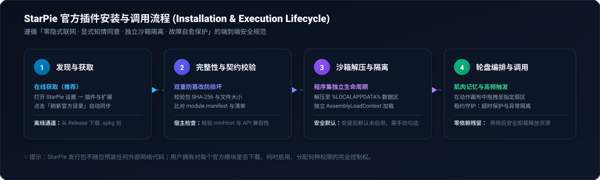
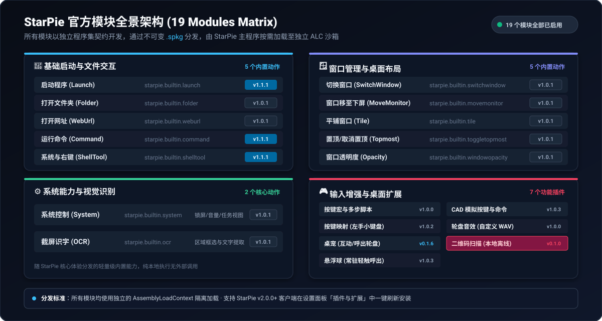

<p align="center">
 
</p>
<p align="center">
  
</p>

# StarPie 官方插件

[](#模块一览)
[](https://github.com/Star-Pie/StarPie/releases/tag/v2.0.0)
[](https://github.com/Star-Pie/StarPie-Official-Plugins/releases)
[](LICENSE)

把常用的启动、窗口、输入和桌面功能放进你的轮盘。这里维护 StarPie 官方插件的源码、构建脚本和独立安装包；主程序见 [StarPie](https://github.com/Star-Pie/StarPie)。

**第一次使用？** [下载主程序](https://github.com/Star-Pie/StarPie/releases/latest) · [查看安装步骤](#安装与使用) · [浏览最新插件发布](https://github.com/Star-Pie/StarPie-Official-Plugins/releases/latest)

## 安装与使用

建议使用当前的 **StarPie v2.0.0 正式版**。具体兼容条件以各模块的最低宿主版本与 SDK 契约为准，客户端会选择兼容版本。

1. 打开 StarPie 设置，进入「**插件与扩展**」。
2. 在「**官方插件**」区域点击「**刷新目录**」。
3. 选择需要的模块，点击「**安装**」，再根据需要启用。
4. 在轮盘动作配置中选择已启用插件提供的动作。轮盘音效等功能通过插件设置管理。

<p align="center">
  
</p>

以上为流程示意图。官方插件通过客户端目录下载和校验；Release 中的 `.spkg` 直链用于归档或检查，社区 `.dll` 手动安装入口不接收这种格式。请勿自行解压到内部数据目录绕过安装流程。

## 模块一览

当前目录包含 **19 个可选模块**。下图按使用场景分组，具体版本与下载链接见 [最新发布说明](https://github.com/Star-Pie/StarPie-Official-Plugins/releases/latest)。

<p align="center">
  
</p>

### 启动与文件

| 模块 | 版本 | 用途 |
|:---|:---:|:---|
| 启动程序 | 1.1.1 | 启动程序或应用，支持参数及标准用户运行方式。 |
| 打开文件夹 | 1.0.1 | 打开目录，或在资源管理器中定位文件。 |
| 打开网址 | 1.0.1 | 使用默认或指定浏览器打开网址。 |
| 运行命令 | 1.1.1 | 在配置的终端中执行命令行。 |
| 系统与右键工具 | 1.1.1 | 调用宿主提供的系统工具与右键菜单功能。 |

### 窗口与系统

| 模块 | 版本 | 用途 |
|:---|:---:|:---|
| 切换窗口 | 1.0.1 | 切换到任务栏指定位置的窗口。 |
| 窗口移到下一屏 | 1.0.1 | 将当前窗口移到下一台显示器。 |
| 平铺窗口 | 1.0.1 | 应用宿主提供的窗口布局。 |
| 窗口置顶/取消置顶 | 1.0.1 | 切换当前窗口的置顶状态。 |
| 窗口透明度 | 1.0.1 | 调节当前窗口的不透明度。 |
| 系统控制 | 1.0.1 | 执行宿主提供的任务视图、音量、锁屏等预设。 |
| 截屏识字 (OCR) | 1.0.1 | 框选区域，交给宿主配置的 OCR 服务处理。 |

### 输入与桌面扩展

| 模块 | 版本 | 用途与入口 |
|:---|:---:|:---|
| 按键宏与多步骤脚本 | 1.0.0 | 编排组合键、文本输入、剪贴板及等待步骤。 |
| 按键映射 | 1.0.2 | 开关自定义按键映射层，提供左手数字小键盘预设。 |
| CAD 模拟按键与命令输入 | 1.0.3 | 面向 CAD 命令输入的文本与模拟按键工具。 |
| 桌宠 | 0.1.6 | 点击呼出宿主轮盘，支持拖动、自定义素材与插件设置。 |
| 悬浮球 | 1.0.3 | 通过悬浮球呼出你配置的轮盘，支持拖动与插件设置。 |
| 轮盘音效 | 1.0.0 | 在插件设置中选择主题、音量及各事件的自定义 WAV。 |
| 二维码扫描 | 0.1.0 | 框选或扫描鼠标附近二维码，预览后选择复制或打开网页链接。 |

## 分发与加载方式

- **按需获取**：主程序发行包不携带官方插件 DLL；插件下载与更新由用户操作触发。
- **完整目录，增量发布**：每次模块集发布包含全部模块的目录；只上传变更模块的包，其余模块继续引用历史 Release 的不可变资产。
- **完整性检查**：签名目录提供包的大小、SHA-256 与兼容条件，客户端在安装流程中核对。
- **进程内加载**：ALC 用于管理程序集加载与卸载，不是安全沙箱，也不提供进程级崩溃隔离。请仅安装信任的插件。

`modules-2026.10.15.1` 已转为 GitHub 正式发布。其原始签名目录中的 `beta` 字段保留，标签、安装包和签名未改写；这与创建新的 stable 目录是不同操作。

<details>
<summary><b>开发、验证与仓库维护</b></summary>

### 本地验证

```powershell
./build/Build-Modules.ps1 -ModuleIds <module-id> -Configuration Release -RunTests
./build/Pack-Module.ps1 -ModuleId <module-id> -Configuration Release -ReleaseTag local -OutputMetadataPath release-metadata/packages/<module-id>.json -Clean
./build/Verify-ModulePackage.ps1 -PackagePath <package-path> -ModuleId <module-id>
pwsh -NoProfile -File tests/catalog/Validate-CatalogV2.ps1
pwsh -NoProfile -File tests/catalog/Validate-ReleaseNotes.ps1
```

### 目录与发布约定

| 路径 | 内容 |
|:---|:---|
| `src/` | 各模块源码与 `plugin.json` |
| `sdk/` | 公共 SDK 契约快照 |
| `build/` | 构建、打包、目录与发布说明生成 |
| `tests/` | 契约、行为与目录验证 |
| `docs/media/` | 品牌横幅、模块图和流程示意 |
| `.github/workflows/` | PR 验证、全量检查与模块集发布 |

共享构建或发布脚本的变动会触发全量模块验证。发布工作流支持 stable/beta 通道与目录基线选择；已有历史包和签名目录不得通过改写来替换。详见 [发布模型](docs/release-model.md)、[安全模型](docs/security-model.md) 与 [贡献指南](CONTRIBUTING.md)。

插件引用公共 SDK；第三方依赖须符合仓库审批约定。二维码扫描包含 ZXing.Net 及对应许可声明。分发包不得携带主程序或私有 SDK 副本。

</details>

源码许可见 [MIT License](LICENSE)。
