<p align="center">
  
</p>

# StarPie 官方插件

[](#模块一览)
[](https://github.com/Star-Pie/StarPie/releases/tag/v2.0.0)
[](https://github.com/Star-Pie/StarPie-Official-Plugins/releases)
[](LICENSE)

把常用的启动、窗口、输入和桌面功能放进你的轮盘。这里维护 StarPie 官方插件的源码、构建脚本和独立安装包；主程序见 [StarPie](https://github.com/Star-Pie/StarPie)。

**第一次使用？** [下载主程序](https://github.com/Star-Pie/StarPie/releases/latest) · [查看安装步骤](#安装与使用) · [浏览最新插件发布](https://github.com/Star-Pie/StarPie-Official-Plugins/releases/latest)

## 安装与使用

建议使用当前的 **StarPie v2.0.0 正式版**。具体兼容条件以各模块的最低宿主版本与 SDK 契约为准，客户端会选择兼容版本。

1. 打开 StarPie 设置，进入「**插件与扩展**」。
2. 在「**官方插件**」区域点击「**刷新目录**」。
3. 选择需要的模块，点击「**安装**」，再根据需要启用。
4. 在轮盘动作配置中选择已启用插件提供的动作。轮盘音效等功能通过插件设置管理。

官方插件通过客户端目录下载和校验。Release 中的 `.spkg` 用于归档或检查，社区 `.dll` 手动安装入口不接收这种格式；请通过客户端安装。

## 模块一览

**19 个插件，19 张实机配置图。** 按场景浏览，点击图片可查看完整配置说明。
截图来自 StarPie v2.0.0 的独立示例配置，未执行插件动作；窗口类功能共用「窗口管理」配置入口。

[启动与文件](#启动与文件) · [窗口管理](#窗口管理) · [系统与识别](#系统与识别) · [输入与桌面扩展](#输入与桌面扩展) · [完整配置图册](docs/plugin-configuration-gallery.md)

### 启动与文件

<table>
<tr>
<td width="50%" valign="top">

<b>启动程序</b> · <code>1.1.1</code>
<p>一个方向，打开常用程序。</p>
<a href="docs/plugin-configuration-gallery.md#launch">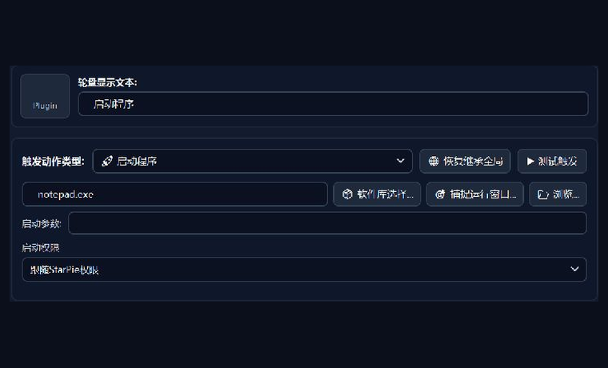</a>
<p><a href="docs/plugin-configuration-gallery.md#launch">查看配置 →</a></p>
</td>
<td width="50%" valign="top">

<b>打开文件夹</b> · <code>1.0.1</code>
<p>直达工作目录，少翻几层文件夹。</p>
<a href="docs/plugin-configuration-gallery.md#folder">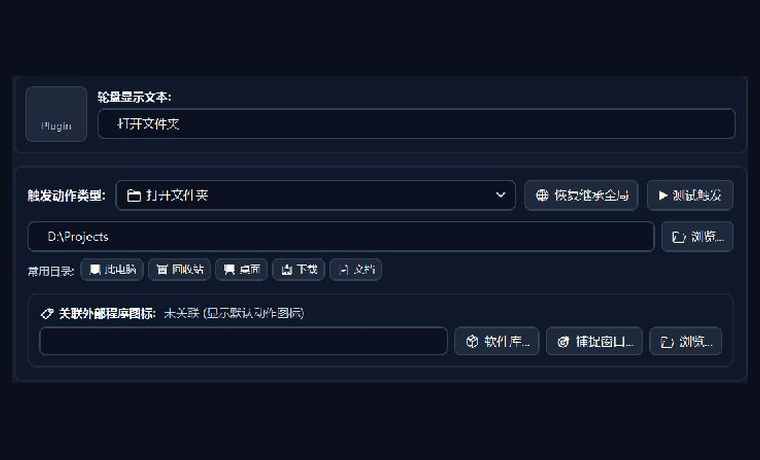</a>
<p><a href="docs/plugin-configuration-gallery.md#folder">查看配置 →</a></p>
</td>
</tr>
<tr>
<td width="50%" valign="top">

<b>打开网址</b> · <code>1.0.1</code>
<p>为常用网页留一个轮盘入口。</p>
<a href="docs/plugin-configuration-gallery.md#weburl">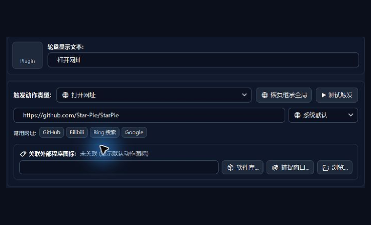</a>
<p><a href="docs/plugin-configuration-gallery.md#weburl">查看配置 →</a></p>
</td>
<td width="50%" valign="top">

<b>运行命令</b> · <code>1.1.1</code>
<p>把常用命令收进轮盘。</p>
<a href="docs/plugin-configuration-gallery.md#command">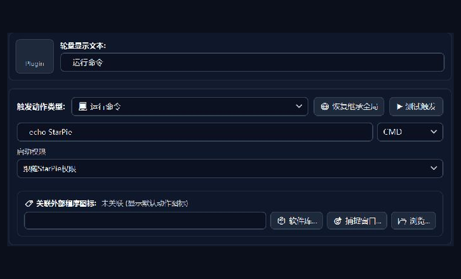</a>
<p><a href="docs/plugin-configuration-gallery.md#command">查看配置 →</a></p>
</td>
</tr>
<tr>
<td width="50%" valign="top">

<b>系统与右键工具</b> · <code>1.1.1</code>
<p>按分类查找系统工具与右键功能。</p>
<a href="docs/plugin-configuration-gallery.md#shelltool">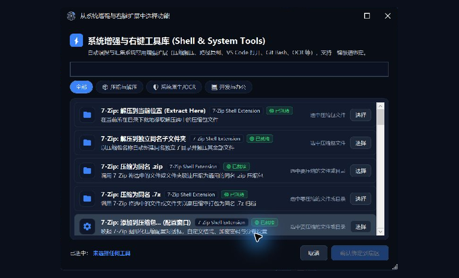</a>
<p><a href="docs/plugin-configuration-gallery.md#shelltool">查看配置 →</a></p>
</td>
<td width="50%" valign="top">
<p><b>按需安装，随时调整。</b></p>
<p>在「插件与扩展」管理模块，在「手势动作」绑定到轮盘。</p>
</td>
</tr>
</table>

### 窗口管理

<table>
<tr>
<td width="50%" valign="top">

<b>切换窗口</b> · <code>1.0.1</code>
<p>按任务栏位置切换窗口。</p>
<a href="docs/plugin-configuration-gallery.md#switchwindow">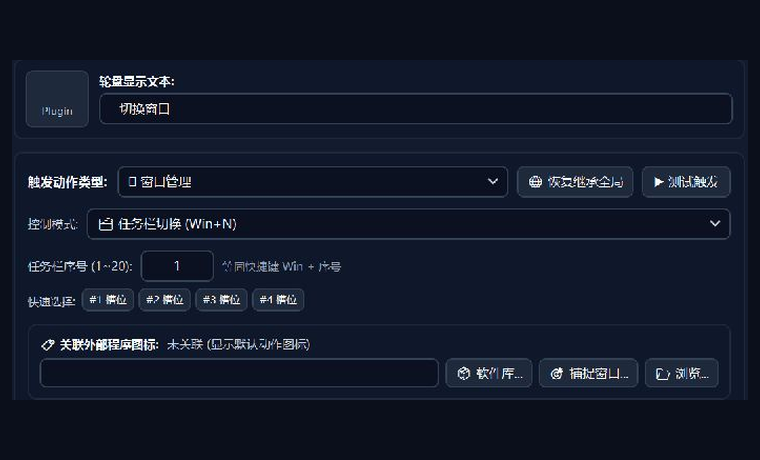</a>
<p><a href="docs/plugin-configuration-gallery.md#switchwindow">查看配置 →</a></p>
</td>
<td width="50%" valign="top">

<b>窗口移到下一屏</b> · <code>1.0.1</code>
<p>把活动窗口移到下一台显示器。</p>
<a href="docs/plugin-configuration-gallery.md#movemonitor">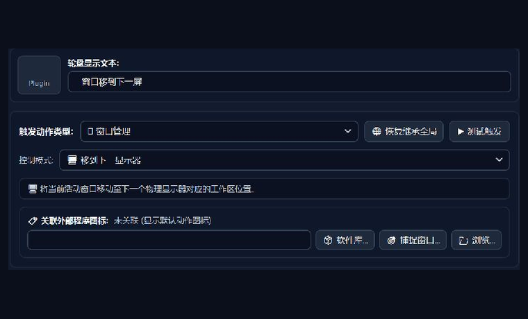</a>
<p><a href="docs/plugin-configuration-gallery.md#movemonitor">查看配置 →</a></p>
</td>
</tr>
<tr>
<td width="50%" valign="top">

<b>平铺窗口</b> · <code>1.0.1</code>
<p>给窗口安排更合适的位置。</p>
<a href="docs/plugin-configuration-gallery.md#tile">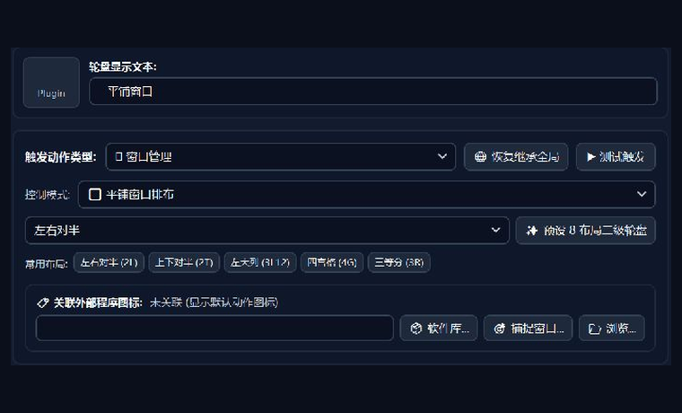</a>
<p><a href="docs/plugin-configuration-gallery.md#tile">查看配置 →</a></p>
</td>
<td width="50%" valign="top">

<b>窗口置顶/取消置顶</b> · <code>1.0.1</code>
<p>让当前窗口保持在前。</p>
<a href="docs/plugin-configuration-gallery.md#toggletopmost">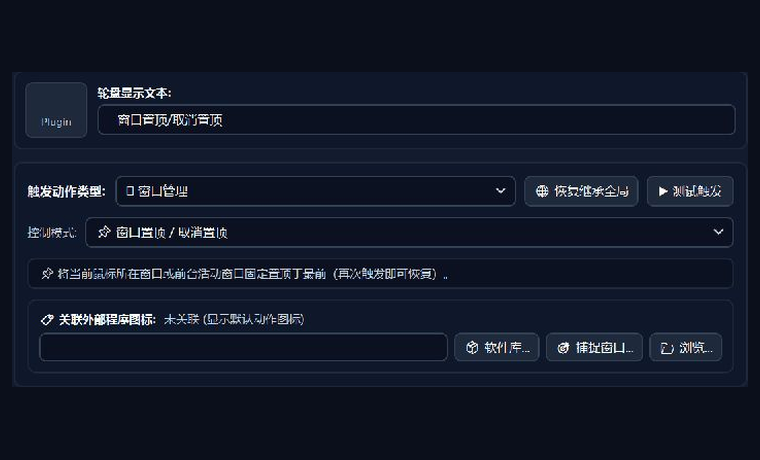</a>
<p><a href="docs/plugin-configuration-gallery.md#toggletopmost">查看配置 →</a></p>
</td>
</tr>
<tr>
<td width="50%" valign="top">

<b>窗口透明度</b> · <code>1.0.1</code>
<p>用预设或滑块调整不透明度。</p>
<a href="docs/plugin-configuration-gallery.md#windowopacity">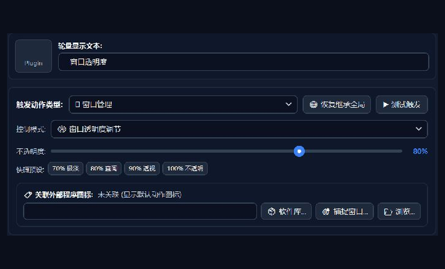</a>
<p><a href="docs/plugin-configuration-gallery.md#windowopacity">查看配置 →</a></p>
</td>
<td width="50%" valign="top">
<p><b>按需安装，随时调整。</b></p>
<p>在「插件与扩展」管理模块，在「手势动作」绑定到轮盘。</p>
</td>
</tr>
</table>

### 系统与识别

<table>
<tr>
<td width="50%" valign="top">

<b>系统控制</b> · <code>1.0.1</code>
<p>任务视图等系统入口，触手可及。</p>
<a href="docs/plugin-configuration-gallery.md#system">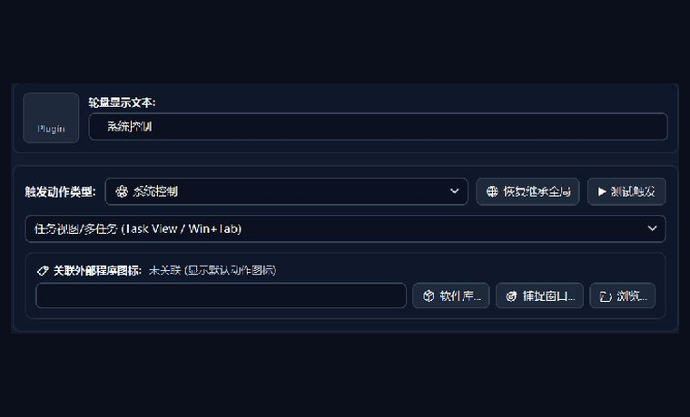</a>
<p><a href="docs/plugin-configuration-gallery.md#system">查看配置 →</a></p>
</td>
<td width="50%" valign="top">

<b>截屏识字 (OCR)</b> · <code>1.0.1</code>
<p>把屏幕里的文字变成可用文本。</p>
<a href="docs/plugin-configuration-gallery.md#ocr">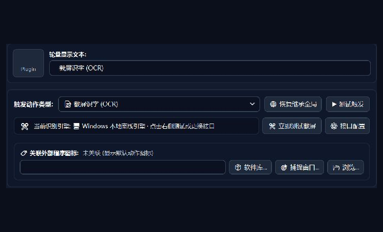</a>
<p><a href="docs/plugin-configuration-gallery.md#ocr">查看配置 →</a></p>
</td>
</tr>
</table>

### 输入与桌面扩展

<table>
<tr>
<td width="50%" valign="top">

<b>按键宏与多步骤脚本</b> · <code>1.0.0</code>
<p>将多个输入步骤编排成一个动作。</p>
<a href="docs/plugin-configuration-gallery.md#macro">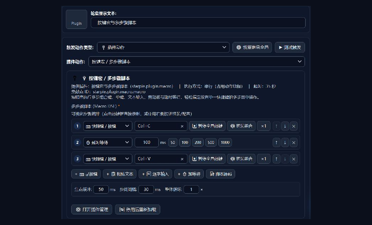</a>
<p><a href="docs/plugin-configuration-gallery.md#macro">查看配置 →</a></p>
</td>
<td width="50%" valign="top">

<b>按键映射</b> · <code>1.0.2</code>
<p>让左手键区变成数字小键盘。</p>
<a href="docs/plugin-configuration-gallery.md#keypadlayer">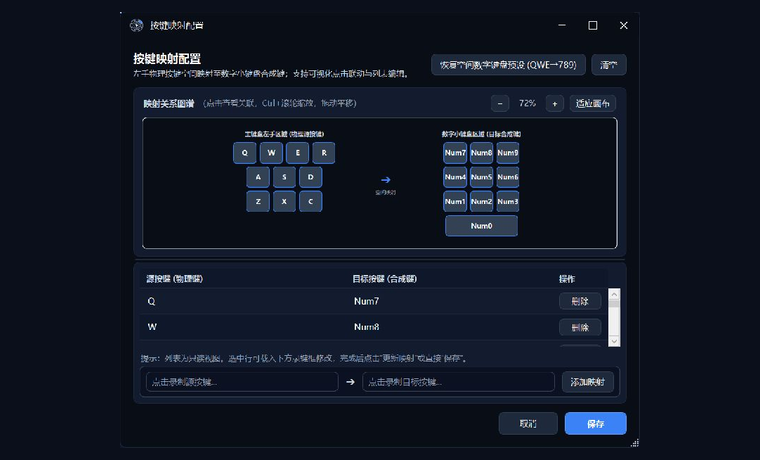</a>
<p><a href="docs/plugin-configuration-gallery.md#keypadlayer">查看配置 →</a></p>
</td>
</tr>
<tr>
<td width="50%" valign="top">

<b>CAD 模拟按键与命令输入</b> · <code>1.0.3</code>
<p>为 CAD 命令配置文本与提交方式。</p>
<a href="docs/plugin-configuration-gallery.md#cadcommand">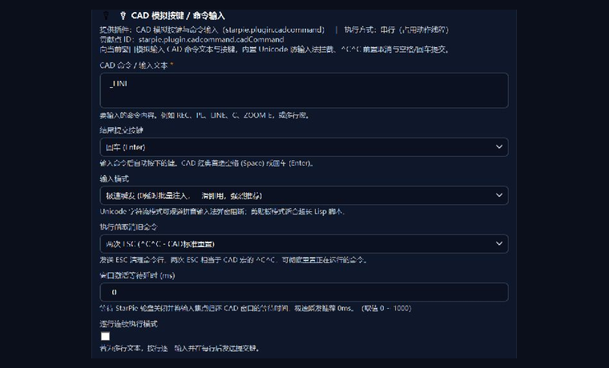</a>
<p><a href="docs/plugin-configuration-gallery.md#cadcommand">查看配置 →</a></p>
</td>
<td width="50%" valign="top">

<b>桌宠</b> · <code>0.1.6</code>
<p>从桌面伙伴唤出你的轮盘。</p>
<a href="docs/plugin-configuration-gallery.md#desktoppet">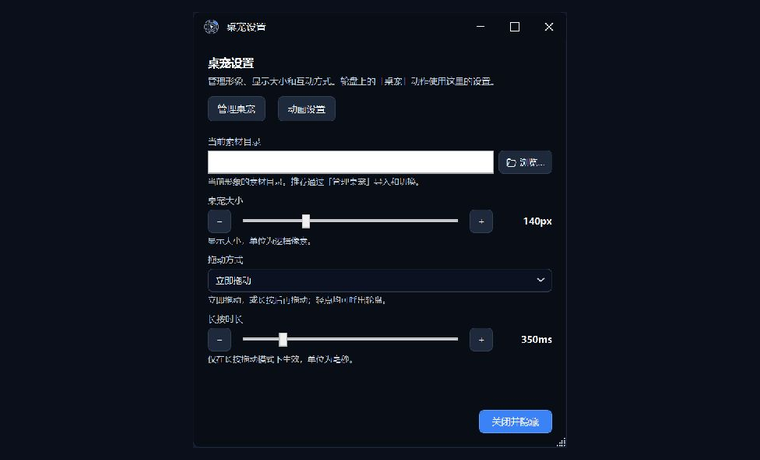</a>
<p><a href="docs/plugin-configuration-gallery.md#desktoppet">查看配置 →</a></p>
</td>
</tr>
<tr>
<td width="50%" valign="top">

<b>悬浮球</b> · <code>1.0.3</code>
<p>给轮盘加一个可拖动的桌面入口。</p>
<a href="docs/plugin-configuration-gallery.md#floatingball">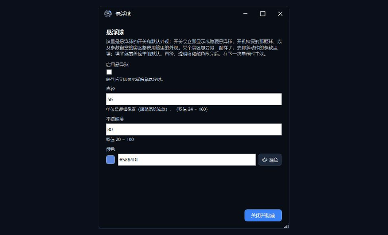</a>
<p><a href="docs/plugin-configuration-gallery.md#floatingball">查看配置 →</a></p>
</td>
<td width="50%" valign="top">

<b>轮盘音效</b> · <code>1.0.0</code>
<p>为轮盘交互加入声音反馈。</p>
<a href="docs/plugin-configuration-gallery.md#sound">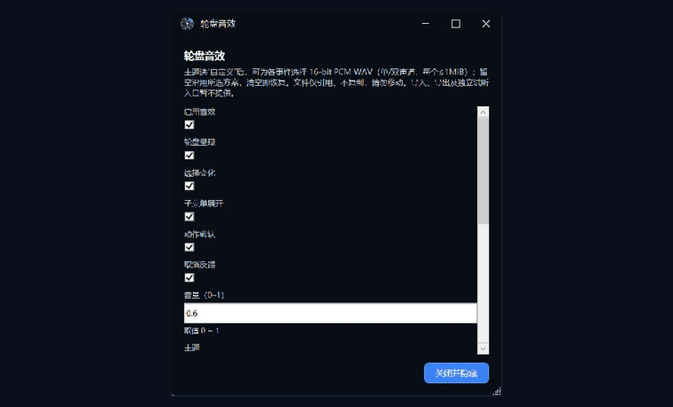</a>
<p><a href="docs/plugin-configuration-gallery.md#sound">查看配置 →</a></p>
</td>
</tr>
<tr>
<td width="50%" valign="top">

<b>二维码扫描</b> · <code>0.1.0</code>
<p>预览二维码内容，再选择后续操作。</p>
<a href="docs/plugin-configuration-gallery.md#qrscanner">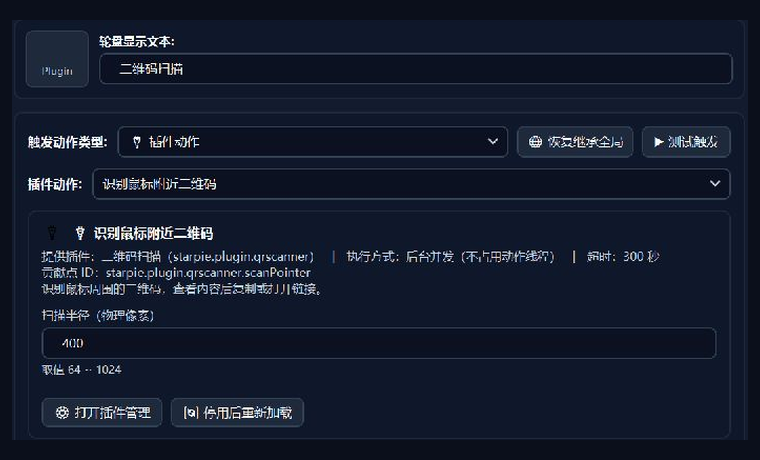</a>
<p><a href="docs/plugin-configuration-gallery.md#qrscanner">查看配置 →</a></p>
</td>
<td width="50%" valign="top">
<p><b>按需安装，随时调整。</b></p>
<p>在「插件与扩展」管理模块，在「手势动作」绑定到轮盘。</p>
</td>
</tr>
</table>

## 分发与加载方式

- **按需获取**：主程序发行包不携带官方插件 DLL；插件下载与更新由用户操作触发。
- **完整目录，增量发布**：每次模块集发布包含全部模块的目录；只上传变更模块的包，其余模块继续引用历史 Release 的不可变资产。
- **完整性检查**：签名目录提供包的大小、SHA-256 与兼容条件，客户端在安装流程中核对。
- **进程内加载**：ALC 用于管理程序集加载与卸载，不是安全沙箱，也不提供进程级崩溃隔离。请仅安装信任的插件。

`modules-2026.10.15.1` 已转为 GitHub 正式发布。其原始签名目录中的 `beta` 字段保留，标签、安装包和签名未改写；这与创建新的 stable 目录是不同操作。

<details>
<summary><b>开发、验证与仓库维护</b></summary>

### 本地验证

```powershell
./build/Build-Modules.ps1 -ModuleIds <module-id> -Configuration Release -RunTests
./build/Pack-Module.ps1 -ModuleId <module-id> -Configuration Release -ReleaseTag local -OutputMetadataPath release-metadata/packages/<module-id>.json -Clean
./build/Verify-ModulePackage.ps1 -PackagePath <package-path> -ModuleId <module-id>
pwsh -NoProfile -File tests/catalog/Validate-CatalogV2.ps1
pwsh -NoProfile -File tests/catalog/Validate-ReleaseNotes.ps1
```

### 目录与发布约定

| 路径 | 内容 |
|:---|:---|
| `src/` | 各模块源码与 `plugin.json` |
| `sdk/` | 公共 SDK 契约快照 |
| `build/` | 构建、打包、目录与发布说明生成 |
| `tests/` | 契约、行为与目录验证 |
| `docs/media/` | 品牌封面与实机配置截图 |
| `docs/plugin-configuration-gallery.md` | 19 个插件的配置入口、截图与示例 |
| `.github/workflows/` | PR 验证、全量检查与模块集发布 |

共享构建或发布脚本的变动会触发全量模块验证。发布工作流支持 stable/beta 通道与目录基线选择；已有历史包和签名目录不得通过改写来替换。详见 [发布模型](docs/release-model.md)、[安全模型](docs/security-model.md) 与 [贡献指南](CONTRIBUTING.md)。

插件引用公共 SDK；第三方依赖须符合仓库审批约定。二维码扫描包含 ZXing.Net 及对应许可声明。分发包不得携带主程序或私有 SDK 副本。

</details>

源码许可见 [MIT License](LICENSE)。
