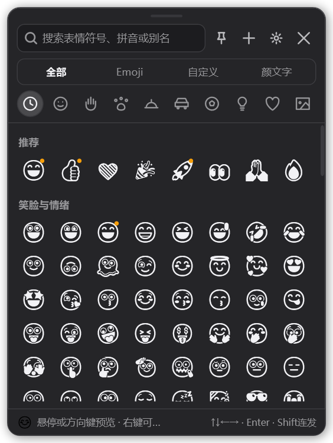
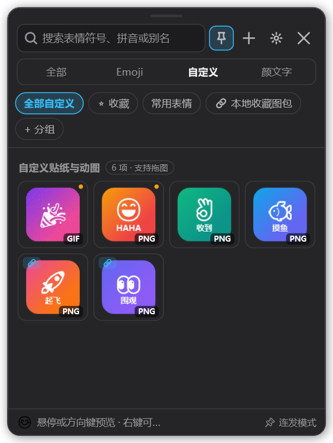
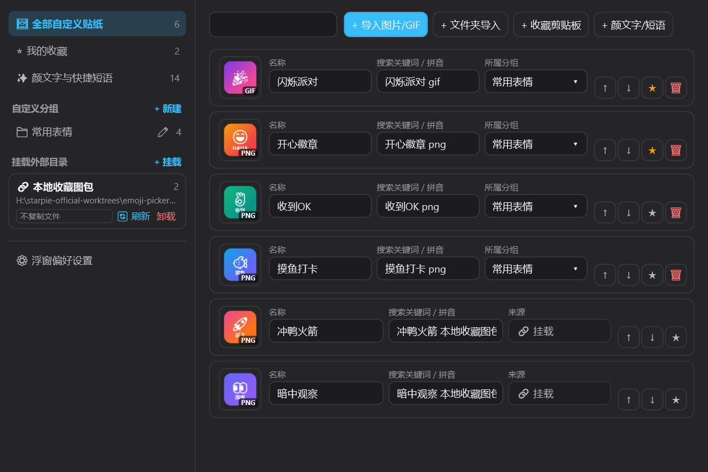

# 表情浮窗 (`starpie.plugin.emojipicker` `0.1.0`) 发布说明

`表情浮窗` 现通过 StarPie 官方插件市场分发，适用于 **StarPie `2.0.1-beta.4` 及以上（SDK `API 1.15`）**，源码位于 [`src/StarPie.Plugin.EmojiPicker`](../src/StarPie.Plugin.EmojiPicker)，遵循 MIT 许可。

## 界面预览

<table>
  <tr>
    <td align="center" width="50%">
       
      默认视图：推荐置顶、内置 144 个 Unicode Emoji、拼音/中英搜索
    </td>
    <td align="center" width="50%">
       
      自定义视图：GIF 动图 / PNG 贴纸、外部挂载分组（🔗）、📌 钉住连发
    </td>
  </tr>
  <tr>
    <td align="center" colspan="2">
       
      独立管理窗口：分组与外部目录挂载管理、行内编辑名称/关键词、调序与偏好设置
    </td>
  </tr>
</table>

> 注：以上界面由真实 WPF 控件视觉树直接渲染；实际 Windows 桌面运行环境会按系统彩色 `Segoe UI Emoji` 及宿主深/浅色主题显示。

## 核心特性

- **无焦点抢占唤出与直接上屏**：轮盘触发「展开表情浮窗」后以 `WS_EX_NOACTIVATE` 浮于光标附近，单击内置 Emoji 或颜文字直接输入原窗口并自动记录最近使用到「推荐」。
- **双态搜索聚焦**：内置 `144` 个去重 Unicode Emoji，支持中文、英文、拼音及多关键词组合筛选；点入搜索框自动切换输入焦点，选中表情或按 `Esc` 后安全还原目标焦点。
- **自定义贴纸 / GIF 动图**：支持 `PNG` / `JPG` / `WebP` / `GIF`（单张 ≤ 4 MiB，文件头 Magic Byte 校验）；鼠标悬停播放 GIF 动画、移开即恢复首帧；贴纸通过序列号保护的剪贴板 + `Ctrl+V` 粘贴并安全恢复原剪贴板纯文本。
- **四大导入方式与零复制挂载**：支持文件直接拖入浮窗导入、多选文件导入、按文件夹批量导入、剪贴板图片一键收藏，以及**挂载外部本地文件夹**（零复制建立动态索引，卸载不删除磁盘原图）。
- **无焦点拖动 & 钉住跨窗口连发**：顶部抓手条与底栏空白处采用 `SWP_NOACTIVATE` 无焦点拖动；点亮 `📌`（或未钉住时按住 `Shift`）可连续发送多个表情，切换记事本 / 浏览器 / 聊天窗口或在外部软件按 `Esc` 均不关闭浮窗，可通过右上角 `✕` 手动关闭。
- **独立管理窗口与多语言自适应**：支持 `zh-CN` / `zh-TW` / `en` / `ja` 四语界面，自动跟随宿主 `Dark` / `Light` 外观配色。

## 安装与使用

1. 打开 **StarPie** 设置，进入「**插件与扩展**」。
2. 在「**官方插件**」区域点击「**刷新目录**」（或在 `v2.0.1-beta.4+` 中通过「**导入插件文件**」选择官方 `.spkg`），找到「**表情浮窗**」点击安装并启用（需授权 `Ui`、`InputSimulation`、`Clipboard`、`FileSystem` 能力）。
3. 在轮盘扇区动作中选择「**插件动作 → 展开表情浮窗**」（可按扇区覆盖默认显示模式）或「**管理自定义表情**」。

> 完整性与边界说明：客户端仅接受与可信目录大小及 SHA-256 一致的官方 `.spkg` 分发包；插件运行在宿主进程内的独立 `AssemblyLoadContext` 中以支持加载与卸载，ALC 不构成安全沙箱或进程级隔离。
