# 官方插件配置图册

[返回 README](../README.md) · [安装与使用](../README.md#安装与使用)

以下是 **StarPie v2.0.0 中的真实配置界面**，使用独立示例数据拍摄。
每张图片对应一个已发布插件版本；只切换、查看与编辑配置，没有执行插件动作。
图片经过裁切以突出字段，未重绘或生成程序界面。[图片来源与拍摄信息](media/IMAGE-SOURCES.md)。

先在「插件与扩展」安装并启用所需模块，再按各节的入口配置。
窗口功能集中在「窗口管理」中选择模式；宏、映射、CAD 与扫码使用「插件动作」分组；
桌宠、悬浮球和音效通过插件卡片的「设置」进入专用面板。

## 启动与文件

[启动程序](#launch) · [打开文件夹](#folder) · [打开网址](#weburl) · [运行命令](#command) · [系统与右键工具](#shelltool)

### 启动程序

一个方向，打开常用程序。

**配置入口：** 手势动作 → 启动程序  
**插件版本：** `1.1.1` · **模块：** `starpie.builtin.launch`

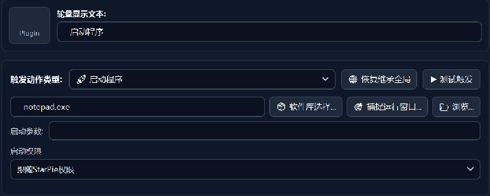

选择程序路径，填写可选启动参数，再选择启动权限。图中使用 `notepad.exe`，权限保持跟随 StarPie。

### 打开文件夹

直达工作目录，少翻几层文件夹。

**配置入口：** 手势动作 → 打开文件夹  
**插件版本：** `1.0.1` · **模块：** `starpie.builtin.folder`

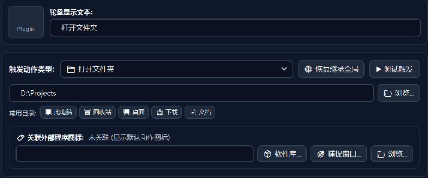

填写目录路径或使用「浏览」。图中 `D:\Projects` 是示例目录；下方常用目录按钮可快速填入系统位置。

### 打开网址

为常用网页留一个轮盘入口。

**配置入口：** 手势动作 → 打开网址  
**插件版本：** `1.0.1` · **模块：** `starpie.builtin.weburl`

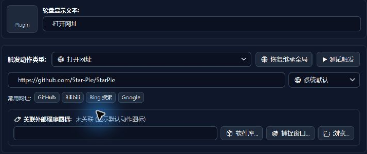

填写完整网址并选择系统默认或指定浏览器。示例指向 StarPie 项目主页，常用网址按钮仅用于填入配置。

### 运行命令

把常用命令收进轮盘。

**配置入口：** 手势动作 → 运行命令  
**插件版本：** `1.1.1` · **模块：** `starpie.builtin.command`

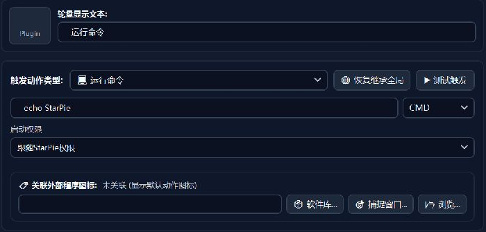

填写命令、选择终端与启动权限。图中为 `echo StarPie` 和 CMD；截图只展示配置，没有执行命令。

### 系统与右键工具

按分类查找系统工具与右键功能。

**配置入口：** 手势动作 → 系统与右键工具 → 挑选功能  
**插件版本：** `1.1.1` · **模块：** `starpie.builtin.shelltool`

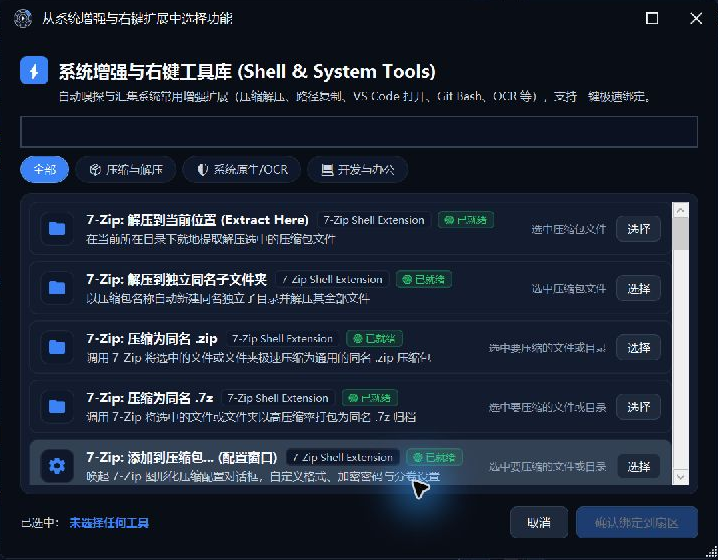

通过搜索与分类查找功能，选择后确认绑定到扇区。图中是实际工具库，内容会随本机安装的软件与可用扩展变化。

## 窗口管理

[切换窗口](#switchwindow) · [窗口移到下一屏](#movemonitor) · [平铺窗口](#tile) · [窗口置顶/取消置顶](#toggletopmost) · [窗口透明度](#windowopacity)

### 切换窗口

按任务栏位置切换窗口。

**配置入口：** 手势动作 → 窗口管理 → 任务栏切换  
**插件版本：** `1.0.1` · **模块：** `starpie.builtin.switchwindow`

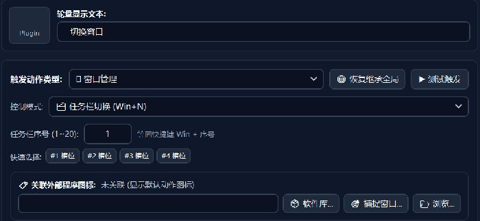

选择任务栏切换模式并填写序号。图中序号为 `1`，相当于配置 Win + 1 对应的窗口切换。

### 窗口移到下一屏

把活动窗口移到下一台显示器。

**配置入口：** 手势动作 → 窗口管理 → 移到下一显示器  
**插件版本：** `1.0.1` · **模块：** `starpie.builtin.movemonitor`

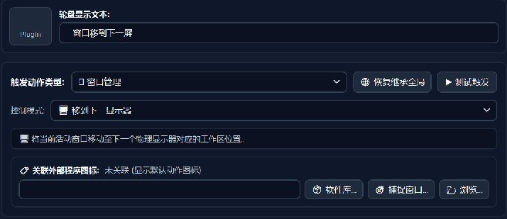

选择跨屏移动模式即可。此动作没有额外参数，实际移动效果取决于多显示器布局。

### 平铺窗口

给窗口安排更合适的位置。

**配置入口：** 手势动作 → 窗口管理 → 平铺窗口布局  
**插件版本：** `1.0.1` · **模块：** `starpie.builtin.tile`

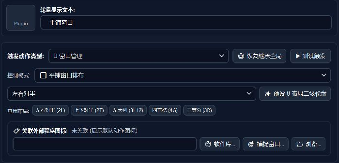

选择平铺布局，也可使用常用布局按钮。图中为左右对半；还可将布局入口配置到 8 方向二级轮盘。

### 窗口置顶/取消置顶

让当前窗口保持在前。

**配置入口：** 手势动作 → 窗口管理 → 窗口置顶 / 取消置顶  
**插件版本：** `1.0.1` · **模块：** `starpie.builtin.toggletopmost`

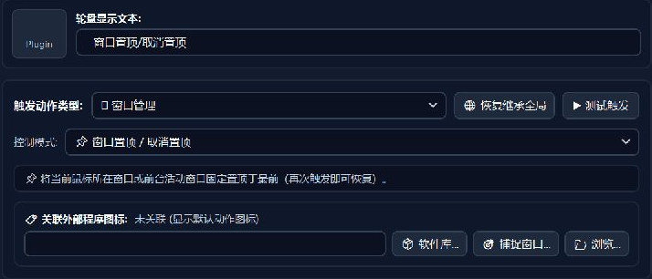

选择置顶切换模式，不需要额外参数。再次触发可恢复，截图展示的是动作绑定界面。

### 窗口透明度

用预设或滑块调整不透明度。

**配置入口：** 手势动作 → 窗口管理 → 窗口透明度调节  
**插件版本：** `1.0.1` · **模块：** `starpie.builtin.windowopacity`

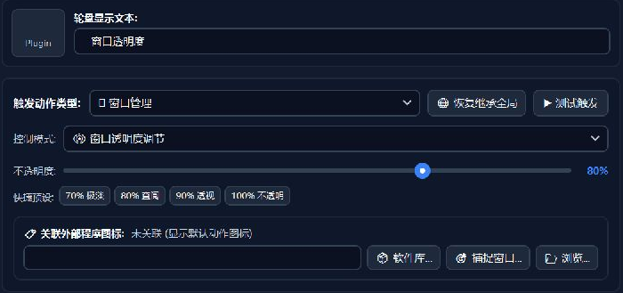

通过滑块或预设配置目标不透明度。示例为 `80%`；`100%` 表示完全不透明。

## 系统与识别

[系统控制](#system) · [截屏识字 (OCR)](#ocr)

### 系统控制

任务视图等系统入口，触手可及。

**配置入口：** 手势动作 → 系统控制  
**插件版本：** `1.0.1` · **模块：** `starpie.builtin.system`

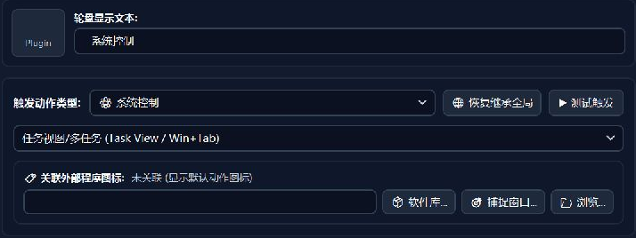

在下拉列表选择宿主提供的系统操作。图中为任务视图 / 多任务，对应 Win + Tab。

### 截屏识字 (OCR)

把屏幕里的文字变成可用文本。

**配置入口：** 手势动作 → 截屏识字 (OCR)  
**插件版本：** `1.0.1` · **模块：** `starpie.builtin.ocr`

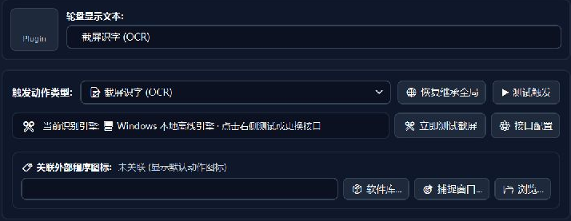

选择 OCR 动作后，界面显示当前识别引擎。「接口配置」用于管理宿主 OCR 服务。图中使用 Windows 本地引擎，未进行截屏识别。

## 输入与桌面扩展

[按键宏与多步骤脚本](#macro) · [按键映射](#keypadlayer) · [CAD 模拟按键与命令输入](#cadcommand) · [桌宠](#desktoppet) · [悬浮球](#floatingball) · [轮盘音效](#sound) · [二维码扫描](#qrscanner)

### 按键宏与多步骤脚本

将多个输入步骤编排成一个动作。

**配置入口：** 手势动作 → 插件动作 → 按键宏 / 多步骤脚本  
**插件版本：** `1.0.0` · **模块：** `starpie.plugin.macro`

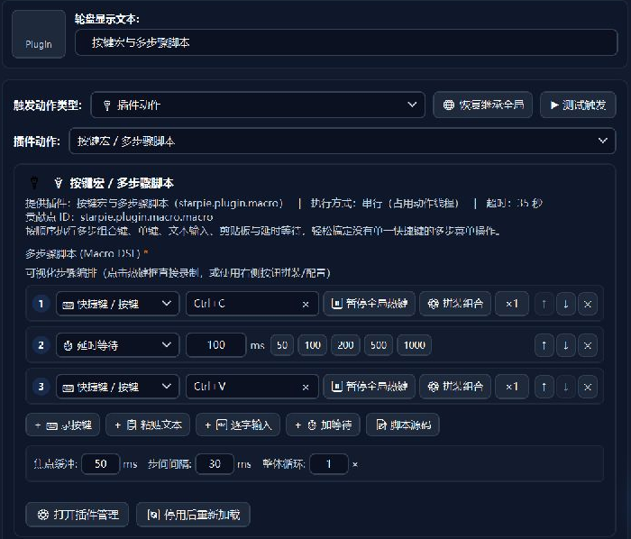

通过可视化步骤编辑器组合按键、等待与文本输入。图中为 Ctrl+C → 等待 100 ms → Ctrl+V，另有焦点缓冲、步骤间隔及整体循环配置。

### 按键映射

让左手键区变成数字小键盘。

**配置入口：** 手势动作 → 插件动作 → 按键映射 → 配置映射  
**插件版本：** `1.0.2` · **模块：** `starpie.plugin.keypadlayer`

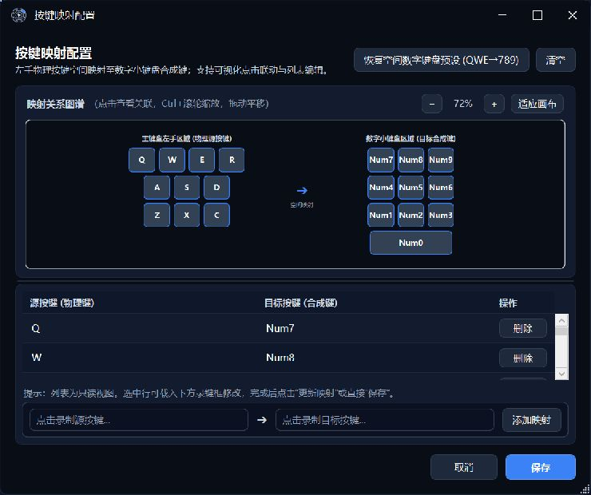

关系图谱联动展示源按键与目标按键，下面可编辑映射。默认预设为 QWE / ASD / ZXC → 789 / 456 / 123，R → 0；本次只查看编辑器，没有开启映射层。

### CAD 模拟按键与命令输入

为 CAD 命令配置文本与提交方式。

**配置入口：** 手势动作 → 插件动作 → CAD 模拟按键 / 命令输入  
**插件版本：** `1.0.3` · **模块：** `starpie.plugin.cadcommand`

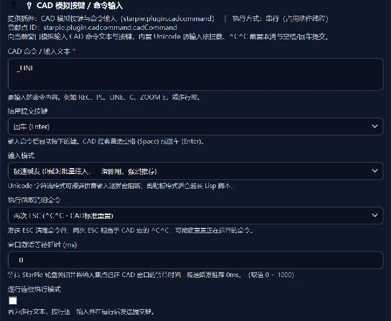

填写命令文本，选择结束提交键、输入模式与执行前取消命令策略。示例为 `_LINE`、Enter、两次 ESC；还可设置等待时间及逐行模式。

### 桌宠

从桌面伙伴唤出你的轮盘。

**配置入口：** 插件与扩展 → 桌宠 → 设置  
**插件版本：** `0.1.6` · **模块：** `starpie.plugin.desktoppet`

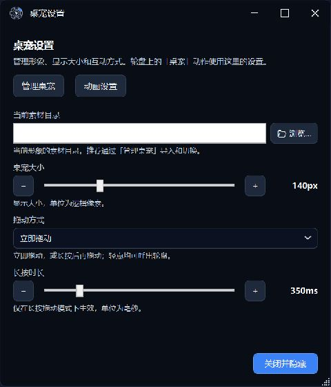

在专用设置中管理素材、动画、显示大小与拖动方式。示例显示大小为 140 px，长按时长为 350 ms；素材尚未导入。

### 悬浮球

给轮盘加一个可拖动的桌面入口。

**配置入口：** 插件与扩展 → 悬浮球 → 设置  
**插件版本：** `1.0.3` · **模块：** `starpie.plugin.floatingball`

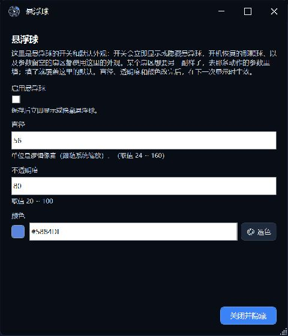

设置悬浮球的启用状态、直径、不透明度与颜色。图中直径为 56、不透明度为 80，启用开关保持关闭。轮盘内容仍由宿主管理。

### 轮盘音效

为轮盘交互加入声音反馈。

**配置入口：** 插件与扩展 → 轮盘音效 → 设置  
**插件版本：** `1.0.0` · **模块：** `starpie.plugin.sound`

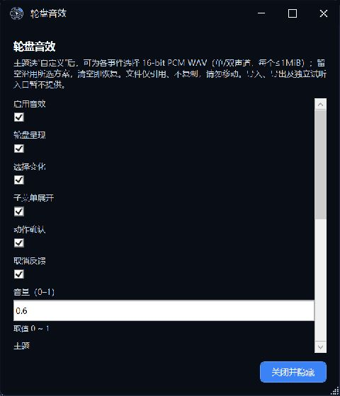

分别管理呈现、选择、子菜单展开、确认和取消事件的声音，并设置音量。继续向下滚动可选择主题与自定义 WAV；截图没有试听或触发声音。

### 二维码扫描

预览二维码内容，再选择后续操作。

**配置入口：** 手势动作 → 插件动作 → 识别鼠标附近二维码  
**插件版本：** `0.1.0` · **模块：** `starpie.plugin.qrscanner`

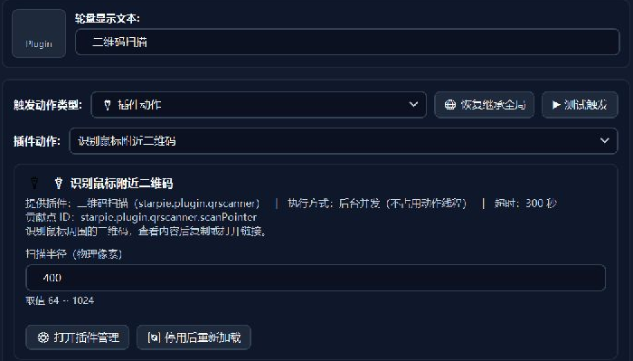

图中配置鼠标附近扫描，半径为 `400` 个物理像素，可填范围为 64–1024。也提供框选扫码动作；本次没有读取屏幕或二维码内容。

